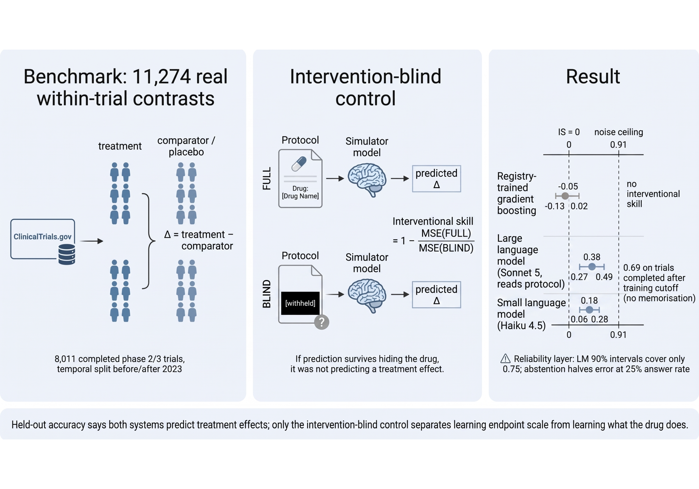

# ivbench: an intervention-blind test of interventional validity for trial simulators

<p align="center">
  
</p>

Anonymous code and data release accompanying the submission

> **Does Your Trial Simulator Know What the Drug Does? An Intervention-Blind Test of Interventional Validity on 8,011 Registered Trials**
> (NeurIPS 2026 Workshop on World Models for High-Stakes Health, under double-blind review)

The benchmark is 11,274 within-trial contrasts (treatment-arm outcome minus comparator-arm outcome on the primary
endpoint) from 8,011 completed phase 2/3 trials with results posted to ClinicalTrials.gov. The measurement is
**interventional skill**: how much error a simulator removes relative to the *same* model trained with every
intervention-identifying field withheld.

## Layout

```
src/ivbench/
  harvest.py       pull completed phase 2/3 interventional trials with posted results (ClinicalTrials.gov API v2)
  parse.py         study record -> arm-level rows (primary outcome, baseline covariates, participant flow, arm role)
  build.py         inclusion rules, within-trial contrasts (risk difference / SMD), temporal + area splits, data card
  models.py        featurizer (TF-IDF+SVD text, ordinal categoricals, numerics), HistGBT, skill + trial bootstrap,
                   split conformal, selective prediction
  specs.py         the four feature specifications (blind, blind_ctrl, full, interv_only) and model/eval wrappers
  llm_prompts.py   exact prompt templates (binary and continuous headers), redaction of intervention tokens,
                   response parser; used unchanged for every language-model run in the paper
scripts/
  run_pipeline.sh          harvest -> parse -> build (regenerates data/ from the live registry; network, ~5 min)
  run_headline.py          seed-0 headline: intervention-blind ablation, conformal coverage, selective curve (~1 min)
  run_positive_control.py  five-seed ablation, noise ceiling, temporal cuts and strata, arm-level task,
                           same-molecule retrieval (~4 min)
  run_shift.py             split conformal under temporal and leave-one-area-out shift, operating points (minutes)
  run_llm_arm.py           protocol-reader language-model arm (needs an API key; see below)
  make_paper_tables.py     cross-checks the numbers quoted in the paper against results/ -> results/paper_numbers.json
  make_figures.py          regenerates paper Figures 1-4 from results/ (no model fitting)
configs/features.yaml      feature groups, for reference
data/                      released benchmark: benchmark_contrasts.csv.gz (11,274 rows), benchmark_arms.csv.gz
                           (40,450 rows), datacard.json (cohort count at every filter)
results/                   every number in the paper is a cell in one of these files; results/README.md maps each
                           paper table and figure to its source file
figures/                   paper figures as shipped (see mapping below) and the graphical abstract
```

The LaTeX source of the paper is provided separately as supplementary material and is not part of this repository.

## Reproduce (no network needed)

```bash
conda env create -f environment.yml && conda activate ivbench

# 1. headline: seed-0 interventional skill, conformal coverage, selective curve  (~1 min)
python scripts/run_headline.py --contrasts data/benchmark_contrasts.csv.gz \
    --arms data/benchmark_arms.csv.gz --out results/headline --seed 0
# -> results/headline/headline.json : interventional_skill = -0.0799, CI [-0.163, -0.012]  (paper Table 6, seed 0)

# 2. positive controls and robustness (Tables 1, 6, 7, 11, 12; noise ceiling in Sec. 3)  (~4 min)
python scripts/run_positive_control.py --out results/positive_control

# 3. conformal coverage under shift (Fig. 3a-b, Tables 13-14)
(cd results/shift && python ../../scripts/run_shift.py)

# 4. cross-check every quoted number, then redraw the figures
python scripts/make_paper_tables.py
python scripts/make_figures.py
```

Step 2 reproduces `results/positive_control/v2_ablation_seeds.csv` (all five seeds), `v2_noise_ceiling.csv`,
`v2_robustness.csv` and `v2_level_task.csv` bit-for-bit, point estimates and bootstrap intervals alike (verified with
scikit-learn 1.9.0 on macOS/arm64; a different BLAS or scikit-learn version may move the last decimal). Intervals use
1,000 trial-level resamples (2,000 for the language-model arm) with a fixed seed; changing `--n-boot` moves only the
intervals. Seeds 1-4 differ from seed 0 by up to 0.07 in interventional skill (Table 6); the paper reports the
five-seed mean.

`run_positive_control.py` reproduces the `name` variant of the same-molecule retrieval control (Table 12). The
`union` variant reported as the headline value in Sec. 5.3 additionally keys on trial-level MeSH intervention terms
that live in the raw harvest (`data/trials_raw.jsonl.gz`, regenerated by `run_pipeline.sh`) and are not carried into
the released contrast table; all 24 variants are in `results/positive_control/v2_same_molecule.csv`.

## Regenerate the benchmark from the registry

```bash
bash scripts/run_pipeline.sh     # writes data/trials_raw.jsonl.gz, then data/benchmark_*.csv.gz and datacard.json
```

The registry is live: a fresh harvest contains trials whose results were posted after our snapshot
(2026-09-09, recorded in `data/datacard.json`) and occasionally corrected records. To reproduce the paper exactly,
use the released `data/` files.

## Language-model arm

The paper's runs used Anthropic models through the Messages API: `claude-sonnet-5` ("large") and
`claude-haiku-4-5-20251001` ("small"). `scripts/run_llm_arm.py` reproduces prompt construction byte-for-byte from
`src/ivbench/llm_prompts.py` (the templates are also printed in Appendix D of the paper) and the parse/retry rule
(one retry with `RETRY_SUFFIX` on parse failure, `max_tokens = 1500`).

```bash
export ANTHROPIC_API_KEY=...
python scripts/run_llm_arm.py --api anthropic --model claude-sonnet-5 --family binary --condition A \
    --out results/llm/rerun_sonnet_binary_A.csv
python scripts/run_llm_arm.py --api anthropic --model claude-sonnet-5 --family binary --condition B \
    --out results/llm/rerun_sonnet_binary_B.csv
```

`--api openai` targets any OpenAI-compatible `/v1/chat/completions` endpoint (`LLM_ENDPOINT`, `LLM_API_KEY`) for
replication with other model families. Condition A shows the intervention, condition B withholds it; interventional
skill is the skill of A with B as the reference, paired by contrast id. Every per-call output used in the paper
(both models, both conditions, both endpoint families, and the repeat run) is in `results/llm/`; the redaction audit of
the blind prompts is `results/llm/llm_redaction_audit_v2.csv`. Language-model outputs are not bit-reproducible across
provider updates; the released files are the record.

## Figure files and paper numbering

| file | paper |
|---|---|
| `figures/fig2_benchmark_skill.png` | Figure 1 |
| `figures/fig3_interventional_forest.png` | Figure 2 |
| `figures/fig4_reliability.png` | Figure 3 |
| `figures/figA_probes.png` | Figure 4 |
| `figures/wmhs_gap_map.png` | Figure 5 (drawn from `results/screen/neurips2025_wmhs_labelled.csv`) |
| `figures/graphical_abstract.png` | graphical abstract (not in the paper) |

File names predate the final numbering and are kept so the paper source compiles unchanged.

## Definitions

* **skill** = 1 - MSE(model) / MSE(reference). The reference is the global training mean unless stated.
* **interventional skill (IS)** = skill of the full model with the intervention-blind model of the same architecture
  as reference (`full` vs `blind_ctrl` in `specs.py`).
* Confidence intervals resample whole trials (`nct_id`), never rows.
* Binary endpoints: proportions, contrast = risk difference. Continuous: standardised mean difference with pooled SD.
* Temporal split: results posted before 2023 = train, 2023 or later = test.

## Licence and citation

Code: MIT. Data (`data/`) and result tables (`results/`): CC BY 4.0; derived from ClinicalTrials.gov, whose records are
in the public domain. See `LICENSE`. Citation metadata is in `CITATION.cff` (anonymous until acceptance; a Zenodo DOI
for `data/` will be minted on acceptance).
